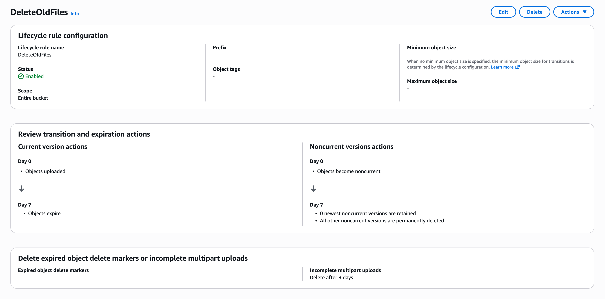

# Supported Storage Providers

- [x] Local filesystem
- [x] AWS S3
- [x] DigitalOcean Spaces
- [x] Google Cloud Storage
- [x] Azure Blob Storage
- [x] Minio

## AWS S3

When using `STORAGE_PROVIDER=s3` (for AWS S3, DigitalOcean Spaces, Minio, etc.), the underlying AWS SDK for JavaScript v3 handles authentication and configuration automatically based on its standard credential provider chain and region discovery:

*   **Credentials**: Provide credentials via environment variables (`AWS_ACCESS_KEY_ID`, `AWS_SECRET_ACCESS_KEY`, and optionally `AWS_SESSION_TOKEN`), a shared credentials file (`~/.aws/credentials`), or an IAM role (on EC2/ECS/Lambda).
*   **Region**: Specify the AWS region using the `AWS_REGION` environment variable or a shared config file (`~/.aws/config`).
*   **S3-Compatible Endpoint**: For services like Minio or DigitalOcean Spaces, you may also need to set the `S3_ENDPOINT` environment variable to the service's specific endpoint URL (e.g., `http://localhost:9000` for local Minio, or `https://nyc3.digitaloceanspaces.com` for DigitalOcean).
*   **Max sockets**: Optionally, set the `S3_MAX_SOCKETS` environment variable to control the maximum number of concurrent connections to the storage service. This can be used to fine-tune performance based on your environment's capabilities.

AWS credentials and configuration are loaded as described in the AWS SDK documentation:

- [Setting Credentials](https://docs.aws.amazon.com/sdk-for-javascript/v3/developer-guide/setting-credentials-node.html)
- [Setting Configuration](https://docs.aws.amazon.com/sdk-for-javascript/v3/developer-guide/setting-region.html)

You should consider adding a lifecycle rule to your bucket in order to remove stale cache data and prevent your bucket from growing infinitely. Here's a simple configuration that removes old objects after 7 days:



### DigitalOcean Spaces

DigitalOcean Spaces is an S3-compatible object storage that this project also supports.

1. Create a [Space](https://cloud.digitalocean.com/spaces).
2. Generate a new [spaces access key](https://cloud.digitalocean.com/account/api/spaces).
3. Fill in the `AWS_ACCESS_KEY_ID` and `AWS_SECRET_ACCESS_KEY` environment variables based on the access key you created.
4. Set `AWS_REGION` to `us-east-1` - [Explanation](https://docs.digitalocean.com/products/spaces/how-to/use-aws-sdks/#configure-a-client)
5. Set `STORAGE_PATH` to the name of the Space you created.
6. Set `S3_ENDPOINT` to the endpoint of the Space you created. For example, `https://nyc3.digitaloceanspaces.com`.
7. Set `STORAGE_PROVIDER` to `s3`.
8. Optionally, set `S3_MAX_SOCKETS` to control the maximum number of concurrent connections to the Space.


## Google Cloud Storage

### Artifact publication and signatures

Artifacts are streamed directly into a GCS object. When signatures are enabled,
the `x-artifact-tag` is included in the upload's custom metadata (`artifact-tag`),
not written as a separate `.tag` object. GCS publishes the body and metadata
atomically, and the server waits for the SDK's upload completion before returning
success. Concurrent uploads can overwrite one another; each published generation
contains one upload's body and tag. Failures before GCS finalizes an upload,
including the tested interrupted streams and streaming `BODY_LIMIT` failures,
leave the prior object untouched. An error response does not prove that an
upload was never published: finalization can succeed before its acknowledgement
is lost, and SDK checksum validation or cleanup can fail after publication.
Preserving the prior object after such post-publication failures is not
guaranteed. No server-local locks or additional object copies are required.

GET reads the object's metadata and streams that exact generation. If an
overwrite removes the selected generation before it can be opened, GET returns
a cache miss instead of combining a new body with an old tag. Object Versioning
is not required; enabling it can keep the selected older generation readable.
HEAD checks the same metadata without downloading the body. Storage failures
other than not-found remain errors, not cache misses.

Existing unsigned objects remain readable when signatures are disabled.
With signatures enabled, objects without an embedded tag are cache misses,
even if a legacy `.tag` object exists: a sidecar cannot prove which body it
belongs to. These entries are rebuilt by clients; do not migrate by copying
sidecar tags onto existing objects. An unsigned overwrite does not retain the
previous generation's tag.

Upgrade all cache-server writers and readers together, draining old instances
before the new instances accept traffic. Mixed old/new versions are not safe
for signed caching: old instances still read and write independent sidecars.
Signed GCS GET and HEAD requests are served by this server even when
`TURBO_CACHE_READ_URL` is set, because an unversioned CDN redirect cannot preserve
the selected body/tag pair. Unsigned CDN redirects are unchanged. Other storage
providers retain their existing publication and sidecar behavior; this guarantee
currently applies only to GCS.

See Google's [consistency guarantees](https://cloud.google.com/storage/docs/consistency)
and [object generation documentation](https://cloud.google.com/storage/docs/metadata#generation-number).
Google recommends [generation preconditions for successive metadata/data reads](https://cloud.google.com/storage/docs/request-preconditions).
The server preserves the generation as a literal string, including values above
JavaScript's safe integer range, using a per-file SDK request interceptor rather
than the SDK's numeric generation constructor option.

### Bucket setup

1. Create a [bucket](https://console.cloud.google.com/storage/browser) (or use an existing one).
2. Create a new [service account](https://console.cloud.google.com/iam-admin/serviceaccounts).
3. Grant the role `Storage Object Admin` to the service account on the bucket.
  ```sh
  # .env
  STORAGE_PROVIDER=google-cloud-storage
  STORAGE_PATH=<name-of-the-bucket>
  ```
### Using static Service Account credentials

1. Click "Create Key" and save the JSON file.
1. Add the `project_id` , `client_email`, and `private_key` from saved JSON file to `.env` (or wherever you manage your environment variables):
  ```sh
  # .env
  GCS_PROJECT_ID=<project_id>
  GCS_CLIENT_EMAIL=<client_email>
  GCS_PRIVATE_KEY=<private_key>
  ```
### Using Application Default Credentials (ADC)

1. Do not set `GCS_*` environment variables
  ```sh
  # .env
  GCS_PROJECT_ID=
  GCS_CLIENT_EMAIL=
  GCS_PRIVATE_KEY=
  ```

##  Azure Blob Storage

1. Create a new Blob Storage.
2. On "Security + networking" tab, copy one of `Connection string` on "Access keys" blade.
3. Set `ABS_CONNECTION_STRING` to the connection string.

## Minio

1. Create Access key
2. Fill in the `AWS_ACCESS_KEY_ID` and `AWS_SECRET_ACCESS_KEY` environment variables based on the access key you created.
3. Create bucket
4. Set `STORAGE_PATH` to the name of the bucket you created.
5. Set `AWS_REGION` (can leave blank `S3_REGION=` for none).
6. Set `STORAGE_PROVIDER` to `minio`.
7. Set `S3_ENDPOINT` to Minio url (ie `http://127.0.0.1:9000`)
8. Optionally, set `S3_MAX_SOCKETS` to control the maximum number of concurrent connections to the Minio instance.
